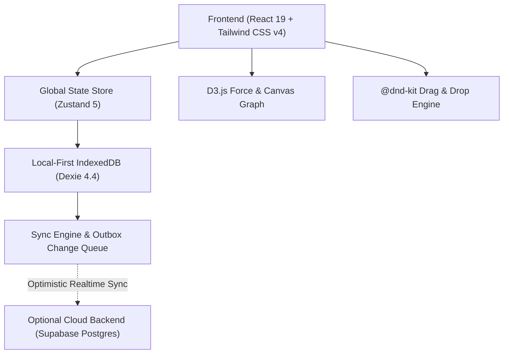

<div align="center">

# ⚡ SANKALP

**Autonomous AI Life Operating System & Cognitive Second Brain**

[](https://aisankalp.vercel.app/)
[](https://react.dev/)
[](https://www.typescriptlang.org/)
[](https://tailwindcss.com/)
[](https://vitest.dev/)
[](https://dexie.org/)

<p align="center">
  <strong>SANKALP</strong> is an enterprise-grade personal operating system built to eliminate app fragmentation, cognitive overload, and task friction. Designed with the high-contrast, futuristic <strong>PRAHARI Enterprise Design System</strong>, it seamlessly unifies Eisenhower matrix task execution, connected markdown knowledge mapping, autonomous AI copilot briefings, and deep-work velocity telemetry into a cohesive command center.
</p>

[**Launch SANKALP Live**](https://aisankalp.vercel.app/) • [**Explore Features**](#-core-features--workspaces) • [**Architecture**](#-architecture--tech-stack) • [**Getting Started**](#-quick-start)

</div>

---

## 🏛️ The 5 Core Life Pillars

SANKALP organizes all tasks, notes, habits, and goals around 5 foundational domains to ensure balanced long-term momentum:

| Pillar | Subtitle | Core Focus | Visual Accent |
| :--- | :--- | :--- | :--- |
| **🔥 Physical** | *The Foundation* | Health, workouts, sleep hygiene, nutrition, physical energy | `Emerald (#00D97E)` |
| **🧠 Mental** | *The Operating System* | Deep work, cognitive clarity, skills, reading, reflection | `Blue (#4D9EFF)` |
| **❤️ Relational** | *The Support Structure* | Family, friendships, network, mentorship, community | `Rose (#FF4D7E)` |
| **✨ Spiritual** | *The Compass* | Purpose, mindfulness, values, gratitude, inner peace | `Purple (#B57BFF)` |
| **📈 Financial** | *The Amplifier* | Wealth accumulation, budgeting, investments, freedom | `Amber (#FBBF24)` |

---

## 🚀 Core Features & Workspaces

### 1. 📊 Executive Dashboard & Telemetry Strip
- **Real-Time Productivity Metrics**: Live counters for *Active Queue*, *Q1 Do First* (Urgent & Important), *7-Day Velocity*, and *Pillar Task Load* with instant sparkline trend pills.
- **Executive Daily Briefing**: One-click autonomous briefing generator summarizing the day's 80/20 leverage points.
- **PRAHARI Enterprise Theme**: Obsidian dark mode (`#05080C`), 24px ambient cyber grid, radial glowing vignettes, and frosted glassmorphism.

### 2. 🎯 Eisenhower Action Matrix
- **4 Action Quadrants**:
  - `Q1 DO`: Urgent & Important (Immediate crisis & deadline focus)
  - `Q2 DECIDE`: Important, Not Urgent (Long-term growth, health, compounding)
  - `Q3 DELEGATE`: Urgent, Not Important (Interrupts, administrative tasks)
  - `Q4 DELETE`: Not Urgent & Not Important (Distractions, noise)
- **Drag-and-Drop Prioritization**: Fluid, accessible drag-and-drop powered by `@dnd-kit` with collision detection and keyboard navigation.

### 3. 🤖 SANKALP AI Copilot & Prompt Engine
- **Autonomous Intelligence**: Slide-out and dockable conversational AI copilot for intelligent daily planning, task breakdown, and executive syntheses.
- **PromptWise AI Engine**: Converts unstructured goals and projects into production-ready prompts formatted for Claude, ChatGPT, and Gemini.

### 4. ⚡ Productivity Acceleration Suite
- **⏱️ Flow Cockpit**: Deep-work Pomodoro timer with estimation multiplier calibration (tracks estimated vs actual completion minutes).
- **🛡️ Resistance Buster**: Diagnoses procrastination triggers (ambiguity, dread, scale, external dependencies) and auto-generates 2-minute micro-starters.
- **⚔️ Decision Duel**: Pairwise comparison tournament algorithm that pit competing tasks head-to-head to definitively declare the #1 priority when overwhelmed.

### 5. 🪄 Smart AI Organizer & Bulk Intake
- **CSV & Text Atomization**: Ingest raw meeting notes, brain dumps, or CSV spreadsheets; the parser categorizes items into actionable tasks or structured notes.
- **Fuzzy Duplicate Detection**: Identifies redundant tasks across quadrants using Levenshtein distance matching.
- **Formatting Hygiene & Splitter**: Cleans up formatting artifacts and decomposes compound tasks into atomic sub-tasks.

### 6. 🌐 Canvas & Graph (Visual Second Brain)
- **Force-Directed Knowledge Graph**: Powered by D3.js to visualize live relationships between tasks, notes, tags, pillars, and domains.
- **2D Spatial Canvas**: Infinite pan-and-zoom whiteboard for spatial note arrangement, grouping, and visual clustering.

### 7. 📝 Connected Markdown Notes
- **Bidirectional Wiki-Linking**: Link notes using `[[Note Title]]` syntax with automatic reverse backlink indexing.
- **Rich Media & Attributes**: Supports checklists, audio attachments, interactive doodles, category tags, and custom color accents.

### 8. 🔄 Weekly Operating Review
- **5-Step Systematic Wizard**:
  1. *Inbox Zero*: One-click pillar & quadrant triage for unclassified items.
  2. *Stalled Tasks*: Surface and resolve tasks stagnant for >7 days.
  3. *Top Priorities*: Lock in the top 3 high-leverage targets for the week.
  4. *Pillars & Archive*: Audit pillar balance and batch-archive completed items.
  5. *Executive Summary*: Weekly velocity retrospective and commitment summary.

### 9. 📱 Mobile Experience
- **Zero-Collision Sticky Header**: Responsive top command bar matching PRAHARI with hamburger menu toggle, centered monospace wordmark, and clean theme/notification controls.
- **Elevated Mobile Dock**: Glassmorphic bottom navigation bar with 4 core workspaces and an elevated central Quick Capture button.
- **Touch Targets**: 40–44px minimum touch targets and mobile-safe insets for iOS and Android.

---

## 🛠 Architecture & Tech Stack



| Layer | Technology | Purpose |
| :--- | :--- | :--- |
| **Framework** | [React 19.2](https://react.dev/) | Component architecture, modern hooks, concurrent features |
| **Build Tool** | [Vite 8.3](https://vitejs.dev/) | Lightning-fast HMR and optimized production bundling |
| **Styling** | [Tailwind CSS v4](https://tailwindcss.com/) | Next-generation utility-first styling with modern CSS variables |
| **State Management** | [Zustand 5.0](https://zustand.docs.pmnd.rs/) | Minimalist reactive state with subscriber middleware |
| **Local Database** | [Dexie.js 4.4](https://dexie.org/) | Robust IndexedDB wrapper enabling 100% offline-first execution |
| **Cloud Sync** | [Supabase](https://supabase.com/) *(Optional)* | PostgreSQL, Realtime WebSocket sync, and Magic Link auth |
| **Visualizations** | [D3.js 7.9](https://d3js.org/) | Force-directed graph physics, zoom behaviors, and drag simulations |
| **Drag & Drop** | [@dnd-kit](https://dndkit.com/) | Accessible, mobile-friendly drag and drop across quadrants |
| **Testing** | [Vitest 5.0](https://vitest.dev/) | 18 test suites covering selectors, outbox sync, wiki-links, and storage |
| **Icons** | [Lucide React](https://lucide.dev/) | Consistent, lightweight vector iconography |
| **Deployment** | [Vercel](https://vercel.com/) | Continuous deployment pipeline with automated edge routing |

---

## 💻 Quick Start

### Prerequisites
- **Node.js**: v18.0.0 or higher
- **npm** or **pnpm**

### Installation

1. **Clone the repository:**
   ```bash
   git clone https://github.com/PRASADSANGALE/Sankalp.git
   cd Sankalp
   ```

2. **Install dependencies:**
   ```bash
   npm install
   ```

3. **Start the local development server:**
   ```bash
   npm run dev
   ```
   Open [http://localhost:5173](http://localhost:5173) in your browser. SANKALP will run in full local-first mode with complete functionality—no accounts or API keys required.

4. **Run the test suite:**
   ```bash
   npx vitest run
   ```
   All 118 unit and integration tests will execute across 18 test suites.

5. **Build for production:**
   ```bash
   npm run build
   ```

---

## ☁️ Optional Cloud Sync (Supabase)

SANKALP is designed **local-first**; your data lives securely in your browser's IndexedDB by default. If you want seamless cross-device synchronization:

1. Create a free project at [supabase.com](https://supabase.com).
2. Open the **SQL Editor** in your Supabase dashboard and execute the script in [`supabase/schema.sql`](./supabase/schema.sql).
3. Under **Authentication > Providers**, verify that the **Email** provider is enabled.
4. Copy your **Project URL** and **anon public key** from **Project Settings > API**.
5. Create a `.env` file in the project root:
   ```env
   VITE_SUPABASE_URL=https://your-project.supabase.co
   VITE_SUPABASE_ANON_KEY=your-anon-public-key
   ```
6. Restart your dev server. You can now sign in using Magic Link, and changes will synchronize across all your authenticated devices in real-time.

---

## 🚀 Production Deployment

SANKALP is continuously deployed to **Vercel** at:
**[https://aisankalp.vercel.app](https://aisankalp.vercel.app)**

### Deploy to your own Vercel instance:
[](https://vercel.com/new/clone?repository-url=https%3A%2F%2Fgithub.com%2FPRASADSANGALE%2FSankalp)

1. Connect your GitHub repository to Vercel.
2. Vercel automatically detects the Vite configuration:
   - **Framework Preset**: `Vite`
   - **Build Command**: `npm run build`
   - **Output Directory**: `dist`
3. If using cloud synchronization, configure `VITE_SUPABASE_URL` and `VITE_SUPABASE_ANON_KEY` under **Environment Variables**.
4. Click **Deploy**.

---

## ⌨️ Keyboard Shortcuts

| Shortcut | Action |
| :--- | :--- |
| `Ctrl + K` / `Cmd + K` | Open Universal Command Palette |
| `Q` | Open Quick Capture Modal |
| `Escape` | Dismiss any open modal, drawer, or dialog |
| `1` – `4` | Filter active view by Pillar |
| `Tab` / `Shift + Tab` | Navigate focus through Eisenhower Matrix tasks |

---

## 🔒 Data Sovereignty & Privacy

- **100% Offline Resilience**: SANKALP functions entirely offline. Your data is stored locally in client-side IndexedDB databases via Dexie.js.
- **Zero Tracking**: No analytical beacons, telemetry trackers, or third-party ads.
- **Complete Export & Import**: Export your entire database as a clean JSON backup at any time from `Settings > Backup & Restore`. Restore onto any browser with snapshot safeguards.

---

## 📄 License

Distributed under the **MIT License**. See `LICENSE` for more information.

---

<div align="center">
  <sub>Built with precision by Prasad Sangale • Powered by the PRAHARI Enterprise Design System</sub>
</div>
